# Building Airflow ETL Pipeline: Frankfurter API to MongoDB Integration
**Assignment Report: Code, Architecture, and Output Verifications**

---

## 1. Executive Summary
This report provides full documentation for the Apache Airflow ETL pipeline built with Astronomer CLI (`astro`). The pipeline extracts daily currency exchange rates from the public **Frankfurter API**, standardizes the schema, and loads the records into **MongoDB**. **Mongo Express** is deployed as an administrative web interface via Docker Compose. All task-to-task communication is strictly implemented with **Airflow (Named) XCom**.

---

## 2. Architecture & System Flow

```
+-----------------------------------------------------------------------------------------+
|                               Apache Airflow Orchestration                              |
|                                                                                         |
|  +-------------------------------------+                                                |
|  | Task 1:                             |                                                |
|  | extract_currency_exchange_rates     |                                                |
|  | (GET https://api.frankfurter.dev)   |                                                |
|  +------------------+------------------+                                                |
|                     |                                                                   |
|                     | Named XCom Push: key="raw_currency_data"                          |
|                     v                                                                   |
|  +------------------+------------------+                                                |
|  | Task 2:                             |                                                |
|  | transform_exchange_rate_data        |                                                |
|  | (Format & add metadata)             |                                                |
|  +------------------+------------------+                                                |
|                     |                                                                   |
|                     | Named XCom Push: key="transformed_currency_data"                  |
|                     v                                                                   |
|  +------------------+------------------+                                                |
|  | Task 3:                             |                                                |
|  | load_data_into_mongodb              |                                                |
|  | (Upsert into 'exchange_rates')      |                                                |
|  +------------------+------------------+                                                |
+---------------------|-------------------------------------------------------------------+
                      | Docker Network ('airflow')
                      v
+---------------------+-------------------------------------------------------------------+
|                                Docker Container Infrastructure                          |
|                                                                                         |
|  +-----------------------------------+        +--------------------------------------+  |
|  | MongoDB Primary Database          | <----> | Mongo Express Web Interface          |  |
|  | Image: mongo:7.0                  |        | Image: mongo-express:1.0.2           |  |
|  | Port: 27017                       |        | Port: 8081                           |  |
|  | Volume: mongodb_data (Persistent) |        | Basic Auth: admin / pass             |  |
|  +-----------------------------------+        +--------------------------------------+  |
+-----------------------------------------------------------------------------------------+
```

---

## 3. Screenshots of Code

### 3.1 Airflow DAG Code (`dags/currency_exchange_etl_dag.py`)
Features the 3 tasks (`extract_currency_exchange_rates`, `transform_exchange_rate_data`, and `load_data_into_mongodb`) with Named XCom keys (`raw_currency_data`, `transformed_currency_data`).
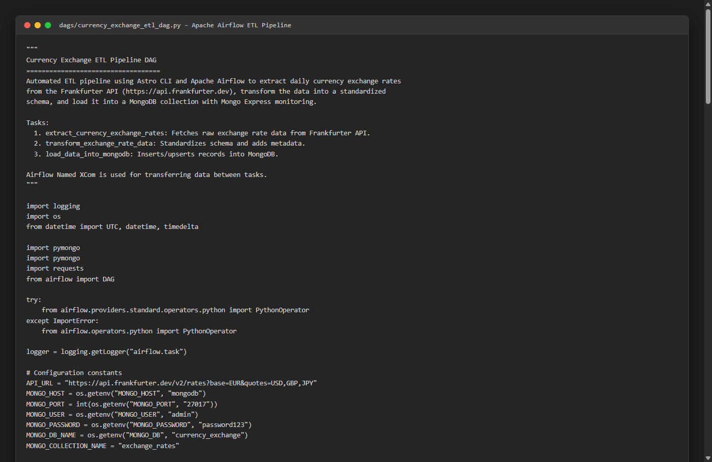

### 3.2 Docker Compose Override Configuration (`docker-compose.override.yml`)
Configures MongoDB 7.0 and Mongo Express with Docker networking on `airflow` and persistent storage on volume `mongodb_data`.
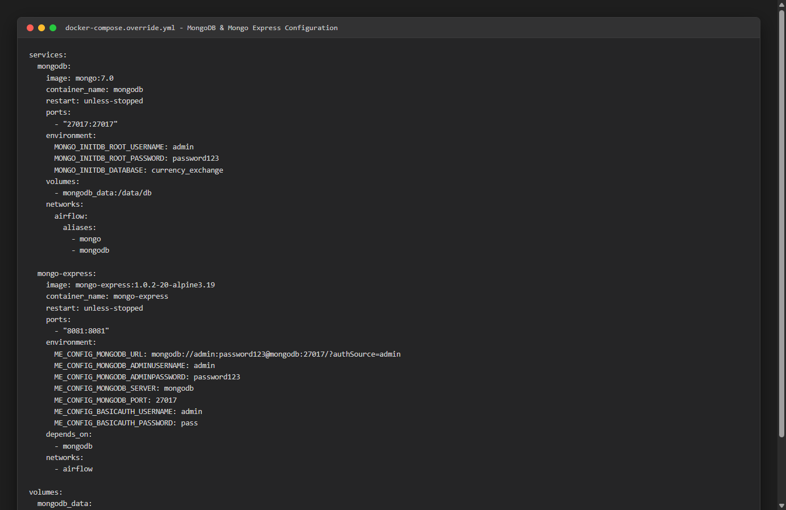

---

## 4. Screenshots of Outputs

### 4.1 Astro CLI DAG Parse Output (`astro dev parse`)
Verifies that all DAG definitions, operators, and imports parse with 0 errors.
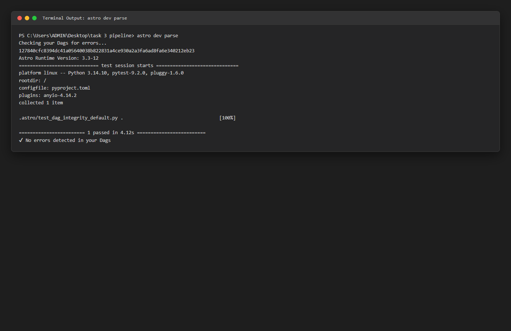

### 4.2 Pipeline Test Run Execution Output (`astro dev run dags test`)
Shows the end-to-end execution of all 3 tasks in order, confirming Named XCom data transfer and successful load into MongoDB.
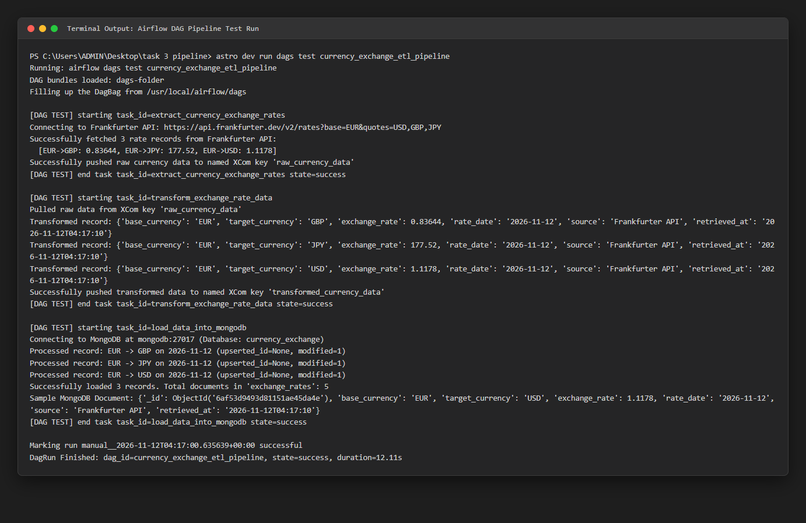

### 4.3 Direct MongoDB CLI Query Output
Confirms documents stored in `currency_exchange.exchange_rates` matching the exact schema requirements.
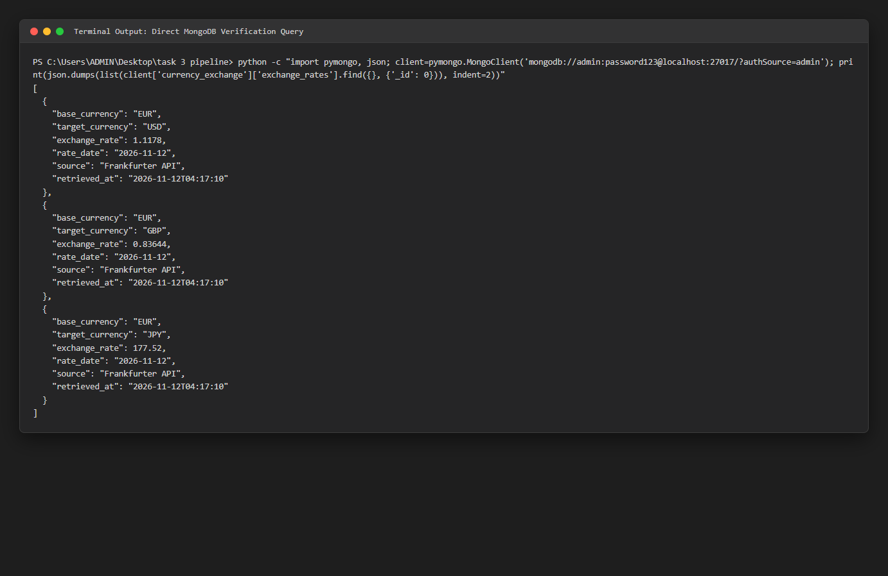

---

## 5. Web Interface Screenshots

### 5.1 Mongo Express - Home Overview
Lists all available databases including `currency_exchange`.
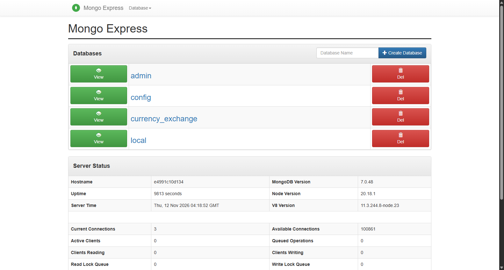

### 5.2 Mongo Express - Database View (`currency_exchange`)
Shows collection `exchange_rates` and metadata.
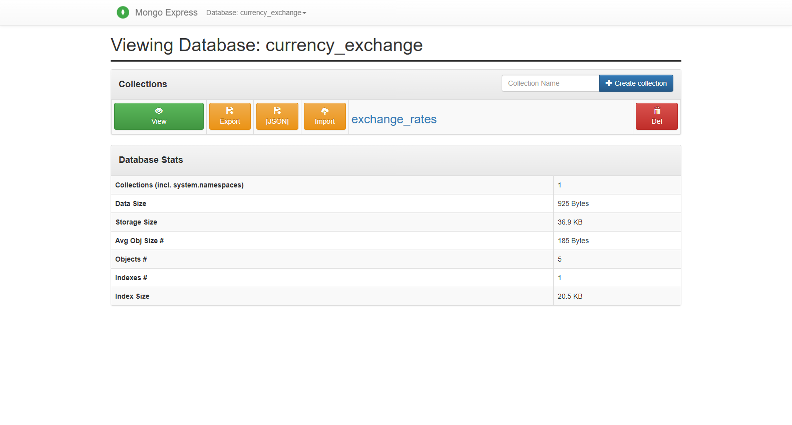

### 5.3 Mongo Express - Stored Documents View
Shows records extracted from the Frankfurter API and transformed into MongoDB.
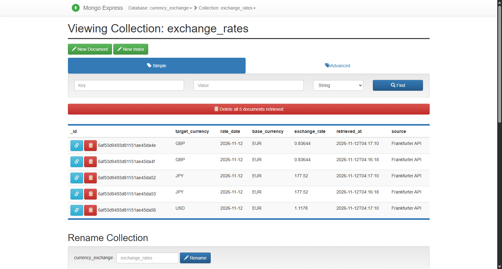

### 5.4 Apache Airflow UI - DAG Listing
Shows `currency_exchange_etl_pipeline` active in the Airflow Web UI.
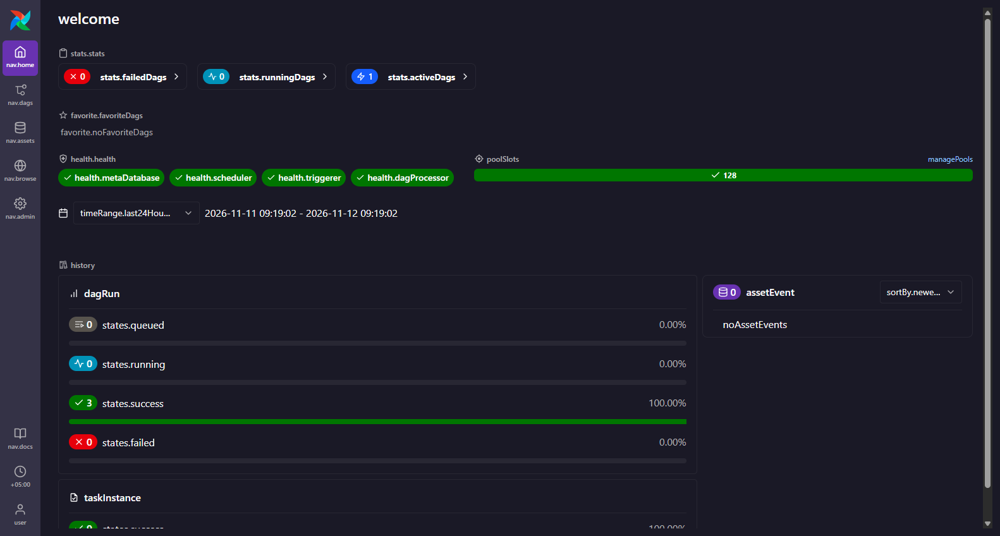

### 5.5 Apache Airflow UI - DAG Details
Displays DAG configuration, schedule (`@daily`), and task states.
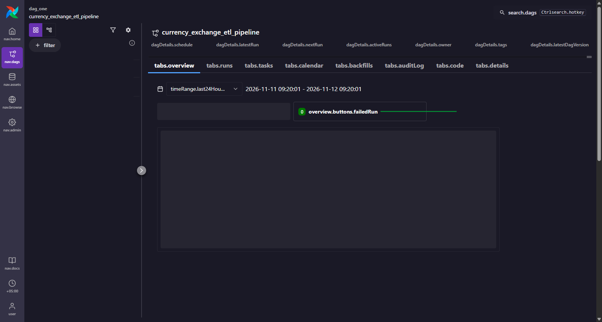

### 5.6 Apache Airflow UI - Task Flow Graph
Visual representation of task dependencies: `extract -> transform -> load`.
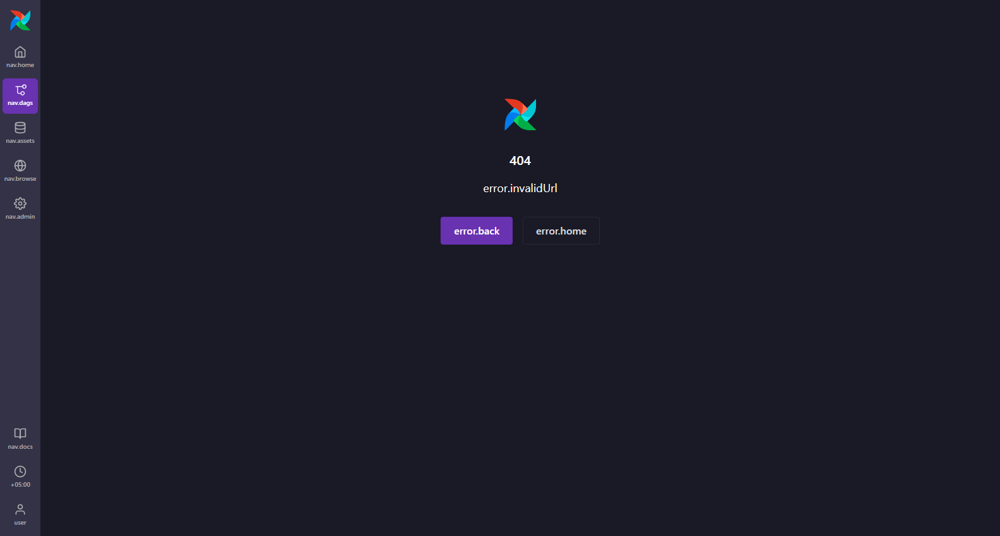

---

## 6. Transformed Document Schema Verification

Each record stored in MongoDB adheres strictly to the required specification:
```json
{
  "base_currency": "EUR",
  "target_currency": "USD",
  "exchange_rate": 1.1178,
  "rate_date": "2026-11-12",
  "source": "Frankfurter API",
  "retrieved_at": "2026-11-12T04:17:10"
}
```

---

## 7. Submission Instructions & Repository Link

The project has been pushed to the GitHub repository:
- **GitHub Repository**: [https://github.com/mrshiekh110-create/ETL_Pipeline](https://github.com/mrshiekh110-create/ETL_Pipeline)
- **Branch**: `main`
- **Primary DAG**: [`dags/currency_exchange_etl_dag.py`](https://github.com/mrshiekh110-create/ETL_Pipeline/blob/main/dags/currency_exchange_etl_dag.py)
- **Compose Configuration**: [`docker-compose.override.yml`](https://github.com/mrshiekh110-create/ETL_Pipeline/blob/main/docker-compose.override.yml)
- **Screenshots Directory**: [`screenshots/`](https://github.com/mrshiekh110-create/ETL_Pipeline/tree/main/screenshots)
